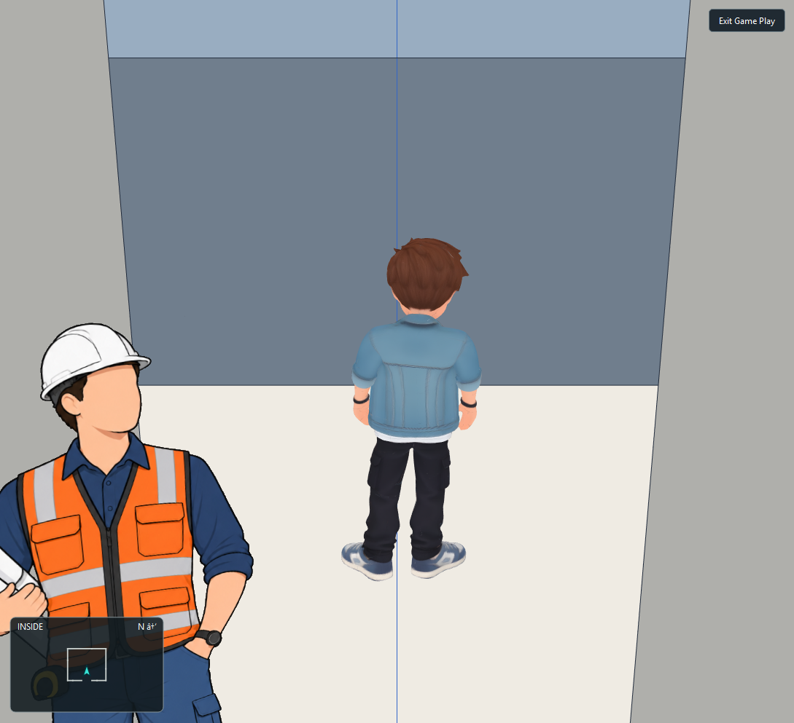

# Game Play for IngeTrazo

Game Play adds a third-person walkthrough to the open IngeTrazo viewport. Click Play, then click a floor to place the included animated character.

- Walk with WASD, hold Shift to run, and use the toolbar to sit or stand.
- Drag to orbit, Shift-drag to pan, and scroll to zoom.
- Follow nearby walls and your heading on the minimap. Its inside/outside label estimates enclosure from the model geometry.
- Dock or float the six-button toolbar. Press Esc or click Exit to restore your editor camera.

**Install on Windows.** Download Game-Play-1.0.0.zip from the release assets. In IngeTrazo, choose Extensions → Open plugins folder. Close IngeTrazo and extract the game_play folder into the plugins folder. Restart, open a model, and choose Extensions → Game Play → Enter Game Play.

Tested in IngeTrazo 0.6.3.2 on Windows.

