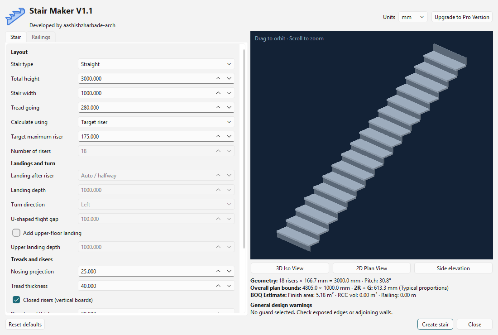

# Stair Maker V1.1 for IngeTrazo

Create editable straight, straight-with-landing, L-shaped and U-shaped stairs. Set the total height, tread going, riser count or target rise. Adjust the landing, nosing and board thickness, then choose open or closed risers and optional glass or steel railings.

## Install or update

Download **Stair-Maker-Free-1.1.1.zip** from the release assets and extract it. Close IngeTrazo, copy `make_stair.py` into `%APPDATA%\ingetrazo\plugins`, and restart. For an existing free installation, replace the previous file. The free and Pro editions use the same filename. Use a separate profile if you want to test both.

## Create and edit

1. Choose a layout on the toolbar. Set dimensions in mm, cm, m, inches or feet.
2. Drag to orbit, scroll to zoom, or switch to plan or side elevation. Review the rise, pitch, footprint, estimated quantities and design warnings.
3. Choose **Create stair**. To revise it, select the stair group and choose **Edit selected stair**. The group stores its dimensions and display unit in the IngeTrazo project.

Developed by **aashishzharbade-arch**. Free edition 1.1.1, tested with IngeTrazo 0.6.2.1 on Windows. Licensed under GPL-3.0-or-later. [Upgrade to Stair Maker Pro](https://ingetrazotutorials.gumroad.com/l/stairmaker_1)
